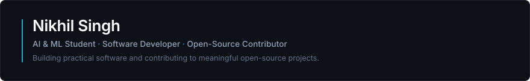

  <!-- Header Banner -->
  

    

  <!-- Animated Typing Subtitle -->
  

   

  <!-- Navigation Bar -->
  

    <a href="#about-me"><b>About</b></a> •
    <a href="#technology-stack"><b>Tech Stack</b></a> •
    <a href="#featured-projects"><b>Projects</b></a> •
    <a href="#open-source-contributions"><b>Open Source</b></a> •
    <a href="#github-activity--analytics"><b>Analytics</b></a> •
    <a href="#current-focus"><b>Current Focus</b></a> •
    <a href="#connect-with-me"><b>Connect</b></a>
  

  

 

## 👨‍💻 About Me

I am a **B.Tech student specializing in Artificial Intelligence & Machine Learning**, focused on building reliable full-stack applications, practicing algorithmic problem-solving, and actively contributing to open-source software.

- 🎓 **Academics:** Pursuing B.Tech in Artificial Intelligence & Machine Learning.
- 💡 **Engineering Philosophy:** Write clean, modular, and well-tested code that solves real problems without unnecessary complexity.
- 💻 **Core Interests:** AI/ML systems engineering, full-stack web development, Data Structures & Algorithms (C++), and developer tools.
- 🛠️ **Dev Environment:** Apple Silicon (macOS on Apple M2) with VS Code, Git, and Unix terminal tooling.
- 🌐 **Open Source Target:** Actively building track records for open-source initiatives including **GSoC** and **LFX Mentorship**.

 

  

 

## 🛠️ Technology Stack

Technologies and tools I have built projects with, categorized by domain:

<table>
  <tr>
    <td width="20%" align="left"><b>Languages</b></td>
    <td>
      
      
      
      
    </td>
  </tr>
  <tr>
    <td align="left"><b>Frontend</b></td>
    <td>
      
      
      
      
    </td>
  </tr>
  <tr>
    <td align="left"><b>Backend</b></td>
    <td>
      
      
      
      
    </td>
  </tr>
  <tr>
    <td align="left"><b>Databases</b></td>
    <td>
      
      
    </td>
  </tr>
  <tr>
    <td align="left"><b>Tools &amp; Environment</b></td>
    <td>
      
      
      
      
      
    </td>
  </tr>
</table>

 

  

 

## 🚀 Featured Projects

A curated selection of meaningful projects built with verified architectures and real codebases:

### 1. [Tarkyaan (तर्कयान) — Autonomous AI Learning Companion](https://github.com/nikhil-singh91/Anant_tark_Tarkyaan)
> **AI/ML &amp; Systems Engineering** • `Python 3.14` • `Pydantic` • `React/TypeScript` • `NOVA Engine`

- **Problem Solved:** Traditional AI tutors hallucinate superficial syllabi without assessing true comprehension or addressing root prerequisite gaps.
- **Architecture &amp; Features:**
  - 20-stage autonomous educational loop diagnosing knowledge states using cognitive graphs and Bayesian prerequisite DAG traversal.
  - Multi-provider LLM routing with guardrails across 6 distinct autonomy levels.
  - Socratic dialogue verification requiring proof of understanding rather than surface regurgitation.
  - Accompanied by a dedicated React/TypeScript showcase client ([MAIN_PAGE_TARKYAAN](https://github.com/nikhil-singh91/MAIN_PAGE_TARKYAAN)).
- **Repository:** [`nikhil-singh91/Anant_tark_Tarkyaan`](https://github.com/nikhil-singh91/Anant_tark_Tarkyaan)

---

### 2. [NOVA (v5) — Modular Personal AI Companion & OS](https://github.com/nikhil-singh91/NOVA_SETUP)
> **AI Infrastructure &amp; Automation** • `Python 3.14` • `Anakin SDK` • `Quartz / AppleScript` • `PyTorch`

- **Problem Solved:** Most AI assistants are stateless single-API wrappers without local operating system control or grounded live web intelligence.
- **Architecture &amp; Features:**
  - Provider-agnostic LLM router dynamically dispatching queries between Gemini, Groq, OpenRouter, and Cerebras.
  - Native live web research powered by the Anakin SDK with normalized citation structures.
  - macOS automation layer leveraging AppleScript and Quartz CG events for tab management, typing, and browser workflows.
  - Strict security design with environment isolation, capability status reporting, and automatic secret redaction.
- **Repository:** [`nikhil-singh91/NOVA_SETUP`](https://github.com/nikhil-singh91/NOVA_SETUP)

---

### 3. [CourierX (TRACK_SWIFT) — Logistics & Parcel Tracking Platform](https://github.com/nikhil-singh91/TRACK_SWIFT)
> **Full-Stack Web Development** • `Node.js` • `Express.js` • `MongoDB / Mongoose` • `Chart.js` • `EJS`

- **Problem Solved:** Provides structured parcel lifecycle tracking and role-separated operational control for logistics dispatch teams and customers.
- **Key Features:**
  - **Multi-Role RBAC:** Dedicated dashboards and permission workflows for Customers, Delivery Agents, and Administrators.
  - **Dynamic Rate Calculator:** Real-time fee computation factoring in base fare, tiered weight surcharges, and pincode destination zones.
  - **Milestone Timeline:** Interactive 5-stage shipment progression tracker (`BOOKED` &rarr; `PICKED_UP` &rarr; `IN_TRANSIT` &rarr; `OUT_FOR_DELIVERY` &rarr; `DELIVERED`).
  - **Audit & Analytics:** Collision-resistant tracking IDs (`CRX-2026-AB12345`) and admin dispatch analytics via Chart.js.
- **Repository:** [`nikhil-singh91/TRACK_SWIFT`](https://github.com/nikhil-singh91/TRACK_SWIFT)

---

### 4. [SkillTrack — Student Learning & Proficiency Dashboard](https://github.com/nikhil-singh91/Skill_track_project)
> **Full-Stack Web Development** • `Node.js` • `Express.js` • `MongoDB` • `JWT / bcryptjs` • `EJS`

- **Problem Solved:** Eliminates fragmented study tracking by providing early-career developers with a unified interface to set measurable learning goals and record technical milestones.
- **Key Features:**
  - Secure authentication using salted passwords (`bcryptjs`) and HTTP-Only JWT cookies.
  - Full CRUD operations for technical skills with visual percentage progress bars (0–100%).
  - Actionable goal tracking with target completion deadlines and real-time dashboard statistics.
  - Strict data isolation ensuring users only access and modify their own records.
- **Repository:** [`nikhil-singh91/Skill_track_project`](https://github.com/nikhil-singh91/Skill_track_project)

 

  

 

## 🌐 Open-Source Contributions

Real pull requests and contributions across external open-source ecosystems:

| Project | Organization / Target | Pull Request &amp; Technical Summary | Status |
| :--- | :--- | :--- | :---: |
| **Gno.land** | [`gnolang/gno`](https://github.com/gnolang/gno) | [**PR #6304**](https://github.com/gnolang/gno/pull/6304): `fix(markdown): sanitize gno tags after block prefixes` Fixed tag sanitation logic in Gno's markdown parser to ensure robust rendering in blockchain documentation. |  |
| **FreeCAD** | [`FreeCAD/FreeCAD`](https://github.com/FreeCAD/FreeCAD) | [**PR #33471**](https://github.com/FreeCAD/FreeCAD/pull/33471): `Improve VoiceOver navigation in Preferences dialog` Enhanced accessibility for macOS screen readers in Qt-based Preferences menus. *(Also investigated [Draft PR #33381](https://github.com/FreeCAD/FreeCAD/pull/33381) for Sketcher text preselection).* |  |
| **Pipedream** | [`PipedreamHQ/pipedream`](https://github.com/PipedreamHQ/pipedream) | [**PR #22190**](https://github.com/PipedreamHQ/pipedream/pull/22190): `feat(tawk_to): add MCP actions` Integrated Model Context Protocol (MCP) action tools for Tawk.to live chat integrations. |  |
| **Student Management** | [`vikash2006-dot/Student-Management-System`](https://github.com/vikash2006-dot/Student-Management-System) | [**PR #13**](https://github.com/vikash2006-dot/Student-Management-System/pull/13): `feat: add role-based access control` [**PR #12**](https://github.com/vikash2006-dot/Student-Management-System/pull/12): `feat: implement delete student functionality` Implemented secure route authorization and complete student record deletion. |  |
| **ShopSphere** | [`vikas0799/shopsphere`](https://github.com/vikas0799/shopsphere) | **11 Production PRs ([#183](https://github.com/vikas0799/shopsphere/pull/183)–[#197](https://github.com/vikas0799/shopsphere/pull/197)):** • DB price recalculation (`#188`) &amp; automated stock reduction (`#191`) • Indian 6-digit pincode validator (`#184`) &amp; debounced product search (`#186`) • GitHub Actions CI pipeline (`#194`), mobile responsiveness (`#185`), dark mode (`#196`) |  |

 

  

 

## 📊 GitHub Activity &amp; Analytics

  <table>
    <tr>
      <td align="center" width="50%">
        
      </td>
      <td align="center" width="50%">
        
      </td>
    </tr>
    <tr>
      <td colspan="2" align="center">
        
      </td>
    </tr>
  </table>

 

  

 

## 🎯 Current Focus

- 🧩 **DSA &amp; Competitive Programming:** Practicing graph theory, dynamic programming, and binary search patterns in modern C++ with an eye toward ICPC.
- 🤖 **AI/ML Systems Engineering:** Developing autonomous agent loops, context-aware reasoning pipelines, and cognitive models (Tarkyaan &amp; NOVA).
- 🏗️ **Full-Stack Architecture:** Building scalable web architectures with Node.js, Express, and React, emphasizing clean REST interfaces and authentication integrity.
- 🌟 **Open-Source &amp; Mentorships:** Expanding code contributions in established organizations (SymPy, FreeCAD, Zulip) while preparing applications for **GSoC** and **LFX Mentorship**.

 

  

 

## 📬 Connect With Me

Feel free to connect, collaborate, or discuss software engineering and open-source opportunities:

  
  &nbsp;&nbsp;
  

 

---

  Designed with care • Built for modern engineering • Verified from source
    
  

